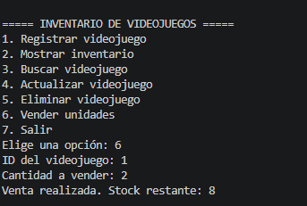
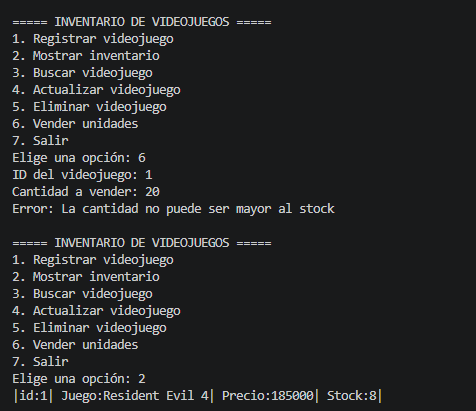

# Sistema de inventario de videojuegos

Aplicación de consola en Python para administrar el inventario de una tienda de videojuegos. Permite registrar, mostrar, buscar, actualizar y eliminar productos (CRUD) y vender unidades, guardando la información en SQLite para que se conserve entre ejecuciones.

El proyecto aplica el patrón **DAO** (*Data Access Object*) y separa el código por capas: cada archivo tiene una única responsabilidad y las consultas SQL viven solo en el DAO.

## Arquitectura

```text
main.py  ──►  producto_servicio.py  ──►  producto_dao.py  ──►  base_datos.py  ──►  tienda.db
(menú)        (reglas del negocio)       (SQL del CRUD)        (conexión y tabla)   (SQLite)
                       └──────────────  modelo.py (Producto)  ──────────────┘
```

Cada capa solo se comunica con la siguiente. `main.py` nunca escribe SQL ni usa el DAO directamente para operar: pide los datos al usuario, llama al servicio y muestra el resultado.

## Estructura de archivos

| Archivo | Responsabilidad |
|---|---|
| `main.py` | Menú interactivo. Pide los datos con `input()`, convierte el texto a número, atrapa los errores y muestra los mensajes. |
| `producto_servicio.py` | Clase `ProductoServicio`. Aplica las validaciones y reglas del negocio y lanza `ValueError` cuando algo no se cumple. |
| `producto_dao.py` | Clase `ProductoDAO`. Contiene todas las operaciones SQL (`INSERT`, `SELECT`, `UPDATE`, `DELETE`). No valida ni imprime. |
| `base_datos.py` | Abre la conexión con SQLite (`obtener_conexion`) y crea la tabla (`inicializar_bd`). |
| `modelo.py` | Clase `Producto`, que representa un videojuego con `id`, `nombre`, `precio` y `stock`. |

## Base de datos

El archivo `tienda.db` se crea automáticamente en la carpeta desde la que se ejecuta el programa.

```sql
CREATE TABLE IF NOT EXISTS productos(
    id INTEGER PRIMARY KEY AUTOINCREMENT,
    nombre TEXT NOT NULL,
    precio INTEGER NOT NULL CHECK (precio > 0),
    stock INTEGER NOT NULL CHECK (stock >= 0)
)
```

Los `CHECK` son una segunda red de seguridad: la validación principal está en el servicio, pero la base de datos también rechaza precios menores o iguales a cero y stock negativo.

## Funcionalidades

| Opción | Operación | Qué hace |
|---|---|---|
| 1 | Registrar videojuego | Solicita nombre, precio y stock, y guarda el producto. Informa el ID asignado. |
| 2 | Mostrar inventario | Lista todos los videojuegos con ID, nombre, precio y stock. |
| 3 | Buscar videojuego | Consulta un producto por ID e informa si no existe. |
| 4 | Actualizar videojuego | Modifica nombre, precio y stock de un producto existente. Si se deja un dato vacío (Enter), se conserva el valor actual. |
| 5 | Eliminar videojuego | Muestra el producto y pide confirmación (`s/n`) antes de eliminarlo. |
| 6 | Vender unidades | Solicita el ID y la cantidad, y descuenta las unidades del stock. |
| 7 | Salir | Finaliza el programa. |

## Validaciones

Las reglas del negocio viven en el servicio. La validación del formato de lo que escribe el usuario (que sea un número entero) vive en `main.py`.

| Situación | Capa | Resultado |
|---|---|---|
| Nombre vacío o solo espacios | Servicio | `El nombre no puede estar vacio` |
| Precio menor o igual a cero | Servicio | `El precio debe ser mayor que cero` |
| Stock negativo | Servicio | `El stock no puede ser negativo` |
| Venta con cantidad menor o igual a cero | Servicio | `La cantidad debe de ser un numero mayor a 0` |
| Venta de más unidades que el stock | Servicio | `La cantidad no puede ser mayor al stock` |
| ID menor o igual a cero | Servicio | `La id debe de ser un numero mayor a 0` |
| ID que no existe (buscar, actualizar, eliminar, vender) | `main.py` | `No existe un producto con ese ID` |
| Texto donde se espera un número | `main.py` | `Debes escribir un número entero` y repite la pregunta |
| Opción de menú inválida | `main.py` | `Opción no válida` |
| Datos rechazados por la base de datos | `main.py` | `Error: la base de datos rechazó esos datos` |

El servicio lanza `ValueError` con el mensaje y `main.py` lo atrapa con `try/except`, muestra el texto y vuelve al menú, de modo que una entrada incorrecta no cierra el programa.

## Decisiones de diseño

- **Una conexión por operación.** Cada método del DAO abre su propia conexión y la cierra en un bloque `finally`, incluso si ocurre un error.
- **Consultas parametrizadas.** Todo el SQL usa `?` en vez de concatenar texto, lo que evita la inyección SQL.
- **Conservar datos al actualizar.** Si el usuario presiona Enter en un campo, el servicio conserva el valor que ya tenía.
- **Confirmación antes de eliminar.** Cualquier respuesta distinta de `s` cancela la eliminación.
- **Sin producto de ejemplo.** Se eliminó el registro automático de «Resident Evil 4» de `main.py`, para que no se duplique en cada ejecución.

## Cómo ejecutar

Requiere **Python 3.10 o superior** (el menú usa `match/case`). SQLite viene incluido en la biblioteca estándar de Python, así que no hay que instalar nada.

Desde la carpeta del proyecto:

```bash
python main.py
```

En algunos sistemas el comando es `python3 main.py`.

Para empezar con una base de datos vacía, cierra el programa y borra el archivo `tienda.db`.

## Pruebas de funcionamiento

Datos usados: **Resident Evil 4**, precio `180000`, stock `10`.

| # | Prueba | Resultado esperado | Evidencia |
|---|---|---|---|
| 1 | Registrar Resident Evil 4 con precio 180000 y stock 10 | Producto guardado correctamente | [captura](capturas/01-registrar.png) |
| 2 | Mostrar inventario | Aparecen los productos registrados | [captura](capturas/02-mostrar.png) |
| 3 | Buscar un ID existente | Se muestran los datos del producto | [captura](capturas/03-buscar-existente.png) |
| 4 | Actualizar un producto | Los cambios quedan guardados en SQLite | [captura](capturas/04-actualizar.png) |
| 5 | Vender 3 unidades de Resident Evil 4 | El stock pasa de 10 a 7 | [captura](capturas/05-venta-exitosa.png) |
| 6 | Intentar vender 20 unidades | Se rechaza la operación y se conserva el stock | [captura](capturas/06-venta-rechazada.png) |
| 7 | Buscar un ID inexistente | Se informa que no existe | [captura](capturas/07-buscar-inexistente.png) |
| 8 | Eliminar un producto | El producto deja de aparecer en el inventario | [captura](capturas/08-eliminar.png) |


### Operación exitosa: venta de 3 unidades



### Operación rechazada: venta de 20 unidades


